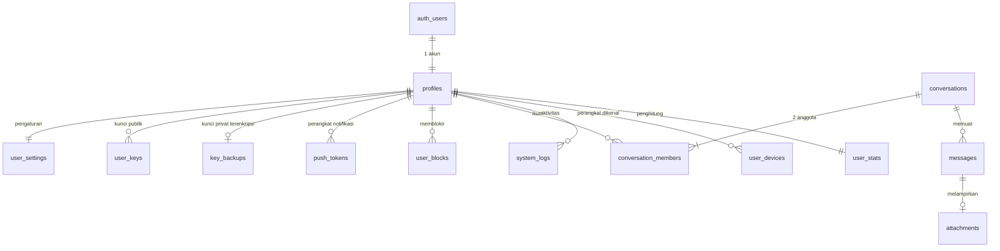

# Rancangan seru24 (Secure Chat, versi sederhana)

Status: **rencana**, belum ada SQL/migrasi yang dijalankan.

Prinsip: sesedikit mungkin komponen, tetapi isi pesan tetap terenkripsi end-to-end dan kode yang sama berjalan di web (Nuxt) dan mobile (React Native/Expo).

## Ruang lingkup

| Masuk | Ditunda |
|---|---|
| Chat 1-ke-1 antar pengguna terdaftar | Grup |
| Teks, gambar, file (maks 10 MB) | Panggilan suara/video |
| E2EE isi pesan dan media | Forward secrecy (Double Ratchet) |
| Blokir pengguna, ban oleh admin | Reaksi emoji, laporan pengguna |
| Cari pengguna dengan username persis | Pencarian isi pesan di server (tidak mungkin dengan E2EE) |
| Pesan berumur (opsional per percakapan) | Permintaan chat (persetujuan sebelum bisa mengirim) |
| Notifikasi push tanpa isi pesan | |

## Desain keamanan

### Kunci

- **Satu pasang kunci X25519 per akun** (bukan per perangkat). Akun yang sama di web dan mobile memakai kunci yang sama, sehingga riwayat terbaca di keduanya tanpa mekanisme multi-device.
- Kunci privat dibuat di perangkat dan tidak pernah dikirim dalam bentuk polos.
- Agar bisa dipakai di perangkat lain, kunci privat dienkripsi dengan **Kode Keamanan Chat** (passphrase terpisah dari password login) lalu disimpan di `key_backups`.
  - Harus terpisah dari password login: password dikirim ke Supabase Auth saat login, jadi kunci yang diturunkan darinya bisa dihitung server.
  - Penurunan: scrypt (RFC 7914) atau Argon2id (RFC 9106), parameter disimpan di `kdf_params`.
  - Lupa kode = kunci privat tidak bisa dipulihkan = pesan lama tidak terbaca. Ini harus dijelaskan di UI.

### Enkripsi pesan

1. `shared = X25519(privat_saya, publik_lawan)` (RFC 7748). Kedua pihak mendapat nilai yang sama.
2. `kunci_percakapan = HKDF-SHA256(shared, salt = conversation_id, info = "seru24/v1/msg" + versi kunci kedua pihak)` (RFC 5869), 32 byte.
3. Isi pesan dienkripsi **AES-256-GCM** (AEAD, NIST SP 800-38D) dengan nonce acak 12 byte per pesan dan tag 16 byte. Nonce acak aman sampai 2^32 pesan per kunci; klien merotasi kunci (`key_version`) jauh sebelum batas itu.
4. AAD = `conversation_id | sender_id | client_msg_id | kind`, supaya ciphertext tidak bisa dipindah ke percakapan atau pengirim lain.
5. Yang disimpan di DB: `ciphertext` + `nonce`. Satu baris per pesan, terbaca oleh kedua pihak.

Media: file dienkripsi di klien dengan kunci acak 32 byte; kunci file, nama, dan tipe MIME ikut di dalam isi pesan terenkripsi. Server hanya melihat blob acak.

### Batasan yang disadari

| Batasan | Mitigasi |
|---|---|
| Tidak ada forward secrecy: kunci privat bocor = semua pesan terbuka | Rotasi kunci (`key_version`), pesan berumur, penyimpanan kunci yang aman; skema bisa dinaikkan ke ratchet nanti tanpa ubah tabel pesan |
| Server yang membagikan kunci publik (bisa menukar kunci / MITM) | Klien menyimpan kunci publik lawan saat pertama dilihat, memperingatkan bila berubah, dan menampilkan sidik jari kunci untuk dicocokkan |
| Metadata terlihat server (siapa, kapan, ukuran) | Diterima untuk versi ini |
| Kunci privat di browser rentan XSS | CSP ketat, tanpa `v-html` untuk isi pesan, kunci dibungkus CryptoKey non-extractable |

### Web dan mobile

| Aspek | Web (Nuxt, Vercel) | Mobile (Expo) |
|---|---|---|
| Kripto | `@noble/curves`, `@noble/hashes`, `@noble/ciphers` (JS murni, teraudit) | library yang sama + `expo-crypto` untuk angka acak |
| Kode bersama | folder `shared/` (kripto, tipe, pemanggilan RPC) dipakai kedua app | sama |
| Sesi | refresh token di cookie httpOnly, Secure, SameSite=Lax yang dikelola server Nitro; access token (JWT singkat) hanya di memori halaman | refresh token di `expo-secure-store`; access token di memori |
| Kunci privat | IndexedDB, dibungkus kunci AES-GCM WebCrypto non-extractable | `expo-secure-store` (Keystore/Keychain) |
| Realtime | Supabase Realtime pada `messages` | sama |
| Notifikasi | Web Push (opsional) | Expo Push (FCM/APNs) |
| Lainnya | header keamanan (CSP, HSTS), service role key hanya di server Nitro | tanpa service role key, tanpa rahasia di bundle |

Referensi: OWASP ASVS V2 (autentikasi), V3 (sesi), V4 (kontrol akses), V6 (kriptografi), V8 (perlindungan data), V12 (unggah file), V14 (konfigurasi/header).

## Diagram relasi

## Tabel

Schema `public`; `auth.users` dikelola Supabase Auth. Semua tabel RLS aktif.

### 1. `profiles` (terlihat pengguna lain)

| Kolom | Tipe | Keterangan |
|---|---|---|
| `id` | uuid PK, FK `auth.users(id)` on delete cascade | |
| `username` | citext unique not null | 3-30 karakter `[a-z0-9_]` |
| `display_name` | text | maks 50 |
| `avatar_path` | text null | bucket `avatars` |
| `banned_at` | timestamptz null | diisi admin; akun dibanned ditolak semua RPC |
| `created_at` | timestamptz default `now()` | |

### 2. `user_settings` (hanya pemilik)

| Kolom | Tipe | Keterangan |
|---|---|---|
| `user_id` | uuid PK, FK `profiles(id)` on delete cascade | |
| `send_read_receipts` | boolean default true | |
| `show_last_seen` | boolean default true | |
| `updated_at` | timestamptz default `now()` | |

### 3. `user_keys` (kunci publik)

| Kolom | Tipe | Keterangan |
|---|---|---|
| `user_id` | uuid FK `profiles(id)` on delete cascade | |
| `key_version` | int | naik saat rotasi |
| `public_key` | text not null | X25519, base64 |
| `created_at` | timestamptz default `now()` | |
| `revoked_at` | timestamptz null | versi lama tetap disimpan untuk membuka pesan lama |

PK `(user_id, key_version)`. Tidak boleh diubah setelah dibuat (hanya `revoked_at`).

### 4. `key_backups` (hanya pemilik)

| Kolom | Tipe | Keterangan |
|---|---|---|
| `user_id` | uuid PK, FK `profiles(id)` on delete cascade | |
| `encrypted_keys` | text not null | semua versi kunci privat, terenkripsi di klien |
| `nonce` | text not null | |
| `kdf` | text not null | `scrypt` / `argon2id` |
| `kdf_params` | jsonb not null | salt, cost |
| `updated_at` | timestamptz default `now()` | |

### 5. `conversations`

| Kolom | Tipe | Keterangan |
|---|---|---|
| `id` | uuid PK | |
| `direct_key` | text unique not null | `least(a,b) \|\| ':' \|\| greatest(a,b)`; satu percakapan per pasangan |
| `disappear_after_seconds` | int null check `> 0` | null = tidak berumur |
| `last_seq` | bigint default 0 | penghitung urutan pesan |
| `last_message_at` | timestamptz null | urutan daftar chat |
| `created_at` | timestamptz default `now()` | |

### 6. `conversation_members` (tepat 2 baris per percakapan)

| Kolom | Tipe | Keterangan |
|---|---|---|
| `conversation_id` | uuid FK on delete cascade | |
| `user_id` | uuid FK `profiles(id)` on delete cascade | |
| `last_read_seq` | bigint default 0 | belum dibaca = `last_seq - last_read_seq` |
| `muted` | boolean default false | |
| `archived` | boolean default false | |
| `pinned` | boolean default false | |
| `joined_at` | timestamptz default `now()` | |

PK `(conversation_id, user_id)`. Index `(user_id)`.

### 7. `messages`

| Kolom | Tipe | Keterangan |
|---|---|---|
| `id` | uuid PK | |
| `conversation_id` | uuid FK on delete cascade | |
| `sender_id` | uuid null FK `profiles(id)` on delete set null | null = akun dihapus |
| `seq` | bigint not null | urutan pasti per percakapan, diisi server |
| `client_msg_id` | uuid not null | idempotensi saat kirim ulang |
| `kind` | text check in (`text`,`image`,`file`) | |
| `ciphertext` | text null | isi terenkripsi; null bila dihapus |
| `nonce` | text null | 12 byte, base64 |
| `sender_key_version` | int not null | versi kunci yang dipakai |
| `recipient_key_version` | int not null | |
| `reply_to` | uuid null FK `messages(id)` on delete set null | |
| `attachment_id` | uuid null FK `attachments(id)` | |
| `created_at` | timestamptz default `now()` | |
| `edited_at` | timestamptz null | edit = ganti `ciphertext` + `nonce` |
| `deleted_at` | timestamptz null | hapus = kosongkan `ciphertext`, hapus lampiran |
| `expires_at` | timestamptz null | pesan berumur |

Unique `(conversation_id, seq)`, unique `(sender_id, client_msg_id)`. Index `(expires_at) where expires_at is not null`.

### 8. `attachments`

| Kolom | Tipe | Keterangan |
|---|---|---|
| `id` | uuid PK | |
| `conversation_id` | uuid FK on delete cascade | |
| `uploader_id` | uuid null FK `profiles(id)` on delete set null | |
| `storage_path` | text not null | `chat-media/{conversation_id}/{uuid}`, nama acak tanpa ekstensi |
| `size_bytes` | bigint check `between 1 and 10485760` | |
| `created_at` | timestamptz default `now()` | |

Nama file dan tipe MIME asli tidak disimpan di sini; keduanya ada di dalam isi pesan terenkripsi.

### 9. `user_blocks`

| Kolom | Tipe | Keterangan |
|---|---|---|
| `blocker_id` | uuid FK `profiles(id)` on delete cascade | |
| `blocked_id` | uuid FK `profiles(id)` on delete cascade | |
| `created_at` | timestamptz default `now()` | |

PK `(blocker_id, blocked_id)`, check `blocker_id <> blocked_id`.

### 10. `push_tokens`

| Kolom | Tipe | Keterangan |
|---|---|---|
| `id` | uuid PK | |
| `user_id` | uuid FK `profiles(id)` on delete cascade | |
| `platform` | text check in (`android`,`ios`,`web`) | |
| `token` | text unique not null | token Expo Push / endpoint Web Push |
| `web_p256dh` | text null | hanya Web Push: kunci publik langganan browser |
| `web_auth` | text null | hanya Web Push: rahasia autentikasi langganan |
| `updated_at` | timestamptz default `now()` | dihapus saat logout |

Isi notifikasi hanya "Pesan baru", tanpa teks pesan maupun nama pengirim bila diinginkan.

### 11. `system_logs`

| Kolom | Tipe | Keterangan |
|---|---|---|
| `id` | bigint identity PK | |
| `user_id` | uuid null FK `profiles(id)` on delete set null | |
| `level` | text not null | `info`, `notice`, `warning`, `error`, `critical` |
| `channel` | text not null | kelompok log: `auth`, `chat`, `key`, `device`, `admin`, `security` |
| `event_code` | text not null | mis. `login_success`, `login_failed`, `register`, `new_device`, `device_revoked`, `key_created`, `key_rotated`, `key_restored`, `password_changed`, `mfa_enabled`, `message_rejected`, `rate_limited`, `access_denied`, `user_blocked`, `user_banned` |
| `message` | text not null | kalimat singkat untuk manusia |
| `context` | jsonb null | data pendukung (mis. alasan penolakan, id percakapan) |
| `extra` | jsonb null | metadata teknis (platform, versi app) |
| `status_code` | smallint null | kode hasil (200, 401, 403, 429, ...) |
| `ip_address` | inet null | |
| `user_agent` | text null | |
| `visitor_key_hash` | text null | sha256 dari `x-visitor-key` |
| `created_at` | timestamptz default `now()` | |

Struktur mengikuti tabel `system_logs` di gaspro (`level`, `channel`, `event_code`, `message`, `context`, `extra`, `user_id`, `ip_address`, `user_agent`, `status_code`, `created_at`), ditambah `visitor_key_hash`.

Index: `(created_at)`, `(level, created_at)`, `(channel, created_at)`, `(channel, event_code)`, `(user_id, created_at)`.

Aturan (ASVS V7): tanpa password, token, kunci, Kode Keamanan Chat, maupun isi pesan; hanya bisa ditambah (tidak ada UPDATE/DELETE untuk siapa pun selain job retensi); waktu dari server; dibersihkan berkala (mis. 90 hari).

### 12. `user_devices` (visitor key, hanya pemilik)

Menyimpan perangkat yang dikenal per akun. Client mengirim header `x-visitor-key` di setiap permintaan; yang disimpan hanya **hash sha256**-nya (sama seperti gaspro), bukan nilai aslinya.

| Kolom | Tipe | Keterangan |
|---|---|---|
| `id` | uuid PK | |
| `user_id` | uuid FK `profiles(id)` on delete cascade | |
| `visitor_key_hash` | text not null | sha256 hex dari `x-visitor-key` |
| `platform` | text check in (`android`,`ios`,`web`) | |
| `name` | text null | mis. "Chrome di Windows" |
| `first_seen_at` | timestamptz default `now()` | |
| `last_seen_at` | timestamptz | |
| `trusted_at` | timestamptz null | diisi setelah Kode Keamanan Chat berhasil di perangkat ini |
| `revoked_at` | timestamptz null | perangkat dicabut pemilik |

Unique `(user_id, visitor_key_hash)`.

Kenapa tabel sendiri dan bukan kolom di `profiles`: satu akun dipakai di web dan mobile (lebih dari satu visitor key), dan `profiles` terbaca pengguna lain sehingga tidak boleh memuat data perangkat.

Cara kerja:

- Mobile: nilai acak 32 byte dibuat saat instalasi, disimpan di `expo-secure-store`. Web: nilai acak 32 byte di `localStorage` (bukan sidik jari browser seperti gaspro: tanpa library pihak ketiga dan tidak mengumpulkan ciri perangkat).
- Setelah login, client memanggil RPC `register_device()`; fungsi membaca header lewat `current_setting('request.headers')`. Visitor key yang belum dikenal dicatat `new_device` di `system_logs` dan pemilik diberi notifikasi.
- RPC sensitif (`send_message`, `start_direct_chat`, akses `key_backups`) menolak bila visitor key tidak terdaftar atau `revoked_at` terisi.
- Ini **lapisan tambahan** (mengikat sesi ke perangkat, ASVS V3), bukan pengganti JWT: header dikirim client sehingga bisa ditiru bila nilainya bocor. Karena itu hanya hash yang disimpan dan nilainya tidak pernah ditulis ke log.

### 13. `user_stats` (penghitung per akun, hanya server)

| Kolom | Tipe | Keterangan |
|---|---|---|
| `user_id` | uuid PK, FK `profiles(id)` on delete cascade | |
| `login_count` | int default 0 | login berhasil |
| `failed_login_count` | int default 0 | gagal berturut-turut; nol lagi saat berhasil |
| `last_login_at` | timestamptz null | |
| `last_failed_login_at` | timestamptz null | |
| `locked_until` | timestamptz null | kunci sementara setelah N kali gagal (ASVS V2.2.1) |
| `messages_sent` | bigint default 0 | pesan diterima server |
| `messages_rejected` | bigint default 0 | ditolak server (diblokir, rate limit, validasi) |
| `attachments_sent` | int default 0 | |
| `reports_received` | int default 0 | berapa kali dilaporkan |
| `last_active_at` | timestamptz null | |

Catatan:

- Login ditangani Supabase Auth, bukan tabel kita. Penghitung login diisi lewat Auth Hook "password verification attempt" (fungsi database yang dipanggil tiap percobaan password; cek ketersediaannya di paket Supabase Anda). Bila tidak tersedia, login berhasil dihitung saat `register_device()` dan login gagal hanya terlihat di log Supabase Auth.
- Penolakan pesan: `send_message` mengembalikan kode hasil, bukan melempar exception. Exception membatalkan transaksi, sehingga penghitung dan baris log ikut hilang.
- Gagal kirim di sisi perangkat (tidak ada jaringan) tidak sampai ke server, jadi tidak terhitung di sini.
- Client tidak punya akses baca/tulis; pemilik melihat info login terakhirnya lewat RPC `my_login_info()`.

### 14. `daily_stats` (rekap harian aplikasi, hanya admin)

| Kolom | Tipe | Keterangan |
|---|---|---|
| `day` | date PK | |
| `registrations` | int | |
| `logins_success`, `logins_failed` | int | |
| `active_users` | int | pengguna dengan aktivitas hari itu |
| `messages_sent`, `messages_rejected` | bigint | |
| `attachments_sent` | int | |
| `reports_opened` | int | |

Diisi job `pg_cron` tiap malam dari `system_logs` dan tabel terkait. Hanya angka agregat, tanpa data per orang.

## Tipe dan ukuran kolom

Bagian ini acuan untuk migrasi. Catatan umum:

- Di PostgreSQL `text` dan `varchar(n)` sama cepatnya; `varchar(n)` dipakai di sini hanya sebagai **batas panjang** supaya client tidak bisa mengirim data berlebihan (ASVS V5, validasi input).
- `uuid` = 16 byte, `timestamptz` = 8 byte, `bigint` = 8 byte, `int` = 4 byte, `boolean` = 1 byte.
- Data biner (kunci, nonce, ciphertext) disimpan sebagai base64 agar mudah lewat JSON; panjang base64 = 4/3 × ukuran asli.

### `profiles`

| Kolom | Tipe | Ukuran isi | Contoh |
|---|---|---|---|
| `id` | `uuid` | 16 byte | `7b1e...c4` |
| `username` | `citext` + check 3-30, regex `^[a-z0-9_]+$` | 3-30 karakter | `zidane_21` |
| `display_name` | `varchar(50)` | 1-50 karakter | `Muhammad Zidane` |
| `avatar_path` | `varchar(128)` null | sekitar 45 karakter | `7b1e.../a91f....webp` |
| `banned_at` | `timestamptz` null | 8 byte | kosong |
| `created_at` | `timestamptz` | 8 byte | |

### `user_settings`

| Kolom | Tipe | Ukuran isi | Contoh |
|---|---|---|---|
| `user_id` | `uuid` | 16 byte | |
| `send_read_receipts` | `boolean` | 1 byte | `true` |
| `show_last_seen` | `boolean` | 1 byte | `true` |
| `updated_at` | `timestamptz` | 8 byte | |

### `user_keys`

| Kolom | Tipe | Ukuran isi | Contoh |
|---|---|---|---|
| `user_id` | `uuid` | 16 byte | |
| `key_version` | `smallint` check `>= 1` | 2 byte | `1` |
| `public_key` | `varchar(44)` + check panjang = 44 | X25519 32 byte = 44 karakter base64 | `hSDwCYkw...Xo=` |
| `created_at` | `timestamptz` | 8 byte | |
| `revoked_at` | `timestamptz` null | 8 byte | kosong |

### `key_backups`

| Kolom | Tipe | Ukuran isi | Contoh |
|---|---|---|---|
| `user_id` | `uuid` | 16 byte | |
| `encrypted_keys` | `varchar(4096)` | sekitar 150 karakter per versi kunci | base64 acak |
| `nonce` | `varchar(16)` + check panjang = 16 | 12 byte = 16 karakter | base64 acak |
| `kdf` | `varchar(16)` check in (`scrypt`,`argon2id`) | 6-8 karakter | `scrypt` |
| `kdf_params` | `jsonb` + check ukuran < 512 byte | sekitar 100 byte | `{"salt":"...","N":32768,"r":8,"p":1}` |
| `updated_at` | `timestamptz` | 8 byte | |

### `conversations`

| Kolom | Tipe | Ukuran isi | Contoh |
|---|---|---|---|
| `id` | `uuid` | 16 byte | |
| `direct_key` | `varchar(73)` | 2 uuid + `:` = 73 karakter | `1a2b...:7b1e...` |
| `disappear_after_seconds` | `int` null, check 60 s.d. 2592000 | 4 byte | `86400` (1 hari) |
| `last_seq` | `bigint` | 8 byte | `152` |
| `last_message_at` | `timestamptz` null | 8 byte | |
| `created_at` | `timestamptz` | 8 byte | |

### `conversation_members`

| Kolom | Tipe | Ukuran isi | Contoh |
|---|---|---|---|
| `conversation_id`, `user_id` | `uuid` | 16 byte masing-masing | |
| `last_read_seq` | `bigint` | 8 byte | `150` |
| `muted`, `archived`, `pinned` | `boolean` | 1 byte masing-masing | `false` |
| `joined_at` | `timestamptz` | 8 byte | |

### `messages`

| Kolom | Tipe | Ukuran isi | Contoh |
|---|---|---|---|
| `id`, `conversation_id`, `sender_id`, `client_msg_id` | `uuid` | 16 byte masing-masing | |
| `seq` | `bigint` | 8 byte | `153` |
| `kind` | `varchar(8)` check in (`text`,`image`,`file`) | 4-5 karakter | `text` |
| `ciphertext` | `text` + check panjang `<= 16384` | pesan pendek sekitar 130 karakter; maksimum sekitar 16 ribu | base64 acak |
| `nonce` | `varchar(16)` + check panjang = 16 | 12 byte = 16 karakter | base64 acak |
| `sender_key_version`, `recipient_key_version` | `smallint` | 2 byte | `1` |
| `reply_to`, `attachment_id` | `uuid` null | 16 byte | kosong |
| `created_at`, `edited_at`, `deleted_at`, `expires_at` | `timestamptz` | 8 byte | |

Isi `ciphertext` sebelum dienkripsi berupa JSON kecil, mis. `{"t":"halo"}` untuk teks, atau `{"t":"caption","file":{"key":"...","name":"foto.jpg","mime":"image/jpeg","size":48213}}` untuk media. Batas teks di klien: 4000 karakter.

Perkiraan ukuran: satu pesan teks pendek sekitar 300 byte, ditambah index sekitar 150 byte. Jadi 1 juta pesan kira-kira 0,4-0,5 GB. Paket gratis Supabase membatasi ukuran database (cek angka terkini di dashboard), sehingga pesan berumur dan pembersihan berkala juga berguna untuk menghemat ruang.

### `attachments`

| Kolom | Tipe | Ukuran isi | Contoh |
|---|---|---|---|
| `id`, `conversation_id`, `uploader_id` | `uuid` | 16 byte masing-masing | |
| `storage_path` | `varchar(128)` | 2 uuid + `/` = 73 karakter | `{conversation_id}/{uuid}` |
| `size_bytes` | `int` check 1 s.d. 10485760 | 4 byte | `48229` |
| `created_at` | `timestamptz` | 8 byte | |

### `user_blocks`

| Kolom | Tipe | Ukuran isi |
|---|---|---|
| `blocker_id`, `blocked_id` | `uuid` | 16 byte masing-masing |
| `created_at` | `timestamptz` | 8 byte |

### `push_tokens`

| Kolom | Tipe | Ukuran isi | Contoh |
|---|---|---|---|
| `id`, `user_id` | `uuid` | 16 byte masing-masing | |
| `platform` | `varchar(8)` check in (`android`,`ios`,`web`) | 3-7 karakter | `android` |
| `token` | `varchar(512)` | Expo sekitar 45 karakter; endpoint Web Push sampai sekitar 400 | `ExponentPushToken[xxxx]` |
| `web_p256dh` | `varchar(100)` null | 88 karakter | hanya web |
| `web_auth` | `varchar(32)` null | 24 karakter | hanya web |
| `updated_at` | `timestamptz` | 8 byte | |

### `system_logs`

| Kolom | Tipe | Ukuran isi | Contoh |
|---|---|---|---|
| `id` | `bigint identity` | 8 byte | `10231` |
| `user_id` | `uuid` null | 16 byte | |
| `level` | `varchar(20)` + check daftar level | 4-8 karakter | `warning` |
| `channel` | `varchar(50)` + check daftar channel | 3-8 karakter | `auth` |
| `event_code` | `varchar(60)` | 8-20 karakter | `login_failed` |
| `message` | `varchar(500)` | sekitar 60 karakter | `Login gagal: password salah` |
| `context` | `jsonb` null + check < 2 KB | sekitar 100 byte | `{"reason":"blocked"}` |
| `extra` | `jsonb` null + check < 2 KB | sekitar 80 byte | `{"platform":"android","app":"1.0.3"}` |
| `status_code` | `smallint` null | 2 byte | `401` |
| `ip_address` | `inet` null | 7-19 byte | `103.10.20.30` |
| `user_agent` | `varchar(500)` null (dipotong) | sekitar 120 karakter | `Mozilla/5.0 ...` |
| `visitor_key_hash` | `char(64)` null | sha256 hex = 64 karakter | `9f2c...` |
| `created_at` | `timestamptz` | 8 byte | |

Perkiraan: sekitar 400 byte per baris log.

### `user_devices`

| Kolom | Tipe | Ukuran isi | Contoh |
|---|---|---|---|
| `id`, `user_id` | `uuid` | 16 byte masing-masing | |
| `visitor_key_hash` | `char(64)` | sha256 hex = 64 karakter | `9f2c...` |
| `platform` | `varchar(8)` | 3-7 karakter | `web` |
| `name` | `varchar(60)` null | sekitar 20 karakter | `Chrome di Windows` |
| `first_seen_at`, `last_seen_at`, `trusted_at`, `revoked_at` | `timestamptz` | 8 byte masing-masing | |

Header `x-visitor-key` sendiri dibatasi 128 karakter (SHA-512 hex) sebelum di-hash; lebih panjang ditolak.

### `user_stats` dan `daily_stats`

Semua penghitung `int` (4 byte) kecuali jumlah pesan `bigint` (8 byte); waktu `timestamptz`; `day` bertipe `date` (4 byte). Satu baris per akun dan satu baris per hari, jadi ukurannya kecil.

## Tabel tambahan yang disarankan (usulan, belum diputuskan)

### Disarankan masuk

**A. `reports`** — laporan pengguna/pesan. Diwajibkan kebijakan Play Store dan App Store untuk aplikasi dengan konten buatan pengguna.

| Kolom | Tipe | Keterangan |
|---|---|---|
| `id` | `uuid` PK | |
| `reporter_id` | `uuid` FK `profiles(id)` on delete set null | |
| `reported_user_id` | `uuid` FK `profiles(id)` on delete cascade | |
| `reason` | `varchar(16)` check in (`spam`,`abuse`,`scam`,`other`) | |
| `note` | `varchar(500)` null | keterangan pelapor |
| `status` | `varchar(12)` check in (`open`,`reviewed`,`dismissed`,`actioned`) default `open` | |
| `created_at`, `reviewed_at` | `timestamptz` | |

Karena E2EE, server tidak bisa membaca pesan yang dilaporkan; pelapor boleh melampirkan teks pesan secara sukarela di `note`.

**B. `app_admins`** — siapa yang boleh mem-ban dan menangani laporan. Tanpa ini `banned_at` tidak punya pelaku yang sah.

| Kolom | Tipe | Keterangan |
|---|---|---|
| `user_id` | `uuid` PK, FK `profiles(id)` on delete cascade | |
| `role` | `varchar(12)` check in (`admin`,`moderator`) | |
| `created_at` | `timestamptz` | |

Hanya diisi lewat SQL oleh pemilik proyek; tidak ada policy tulis untuk client.

**C. `rate_limits`** — penghitung pemanggilan RPC (`search_user`, `start_direct_chat`, `send_message`, `username_available`). Fungsi database butuh tempat menyimpan hitungan.

| Kolom | Tipe | Keterangan |
|---|---|---|
| `user_id` | `uuid` FK `profiles(id)` on delete cascade | |
| `action` | `varchar(24)` | nama aksi |
| `window_start` | `timestamptz` | awal jendela (mis. per menit) |
| `count` | `int` | |

PK `(user_id, action, window_start)`. Tanpa akses client sama sekali; dibersihkan `pg_cron`.

**D. Permintaan chat (kolom, bukan tabel)** — tambah di `conversations`: `status varchar(8)` check in (`pending`,`accepted`) dan `requested_by uuid`. Pesan pertama dari orang asing masuk ke "Permintaan"; penerima menerima atau memblokir. Mencegah spam tanpa tabel baru.

### Opsional

**E. `reserved_usernames`** (`username citext` PK) — melarang nama seperti `admin`, `support`, `seru24`, dan menahan username akun yang dihapus agar tidak dipakai untuk menyamar.

**F. `app_versions`** (`platform varchar(8)` PK, `min_version varchar(16)`, `latest_version varchar(16)`) — memaksa pembaruan aplikasi mobile bila ada perbaikan keamanan pada kode kripto.

### Tidak perlu tabel

- Daftar perangkat/sesi login: sudah ada di `auth.sessions`, cukup dibuka lewat RPC (lihat dan cabut sesi).
- Status mengetik dan online: Realtime Presence.
- Sidik jari kunci lawan bicara yang sudah diverifikasi: disimpan lokal di perangkat.

## Fungsi (RPC)

Client tidak menulis langsung ke `conversations`, `conversation_members`, dan `messages`; semuanya lewat fungsi ini.

| Fungsi | Tugas |
|---|---|
| `username_available(username)` | cek saat daftar; dibatasi rate limit |
| `search_user(username)` | cocok persis, maks 1 hasil; tidak mengembalikan akun dibanned atau yang memblokir pemanggil |
| `start_direct_chat(target_id)` | buat atau kembalikan percakapan berdasarkan `direct_key`; tolak bila diblokir |
| `send_message(conversation_id, client_msg_id, kind, ciphertext, nonce, versi kunci, reply_to, attachment_id)` | cek anggota, blokir, ban; idempoten; isi `seq`; perbarui `last_message_at` dan `expires_at` |
| `edit_message(id, ciphertext, nonce)` / `delete_message(id)` | hanya pengirim |
| `mark_read(conversation_id, seq)` | perbarui `last_read_seq` |
| `is_member(conversation_id)` | bantu RLS (`security definer`) |

Pesan dari pengguna yang diblokir ditolak dengan galat generik, tanpa memberi tahu bahwa ia diblokir.

## Aturan RLS

| Tabel | SELECT | INSERT | UPDATE | DELETE |
|---|---|---|---|---|
| `profiles` | user login | trigger | milik sendiri (bukan `banned_at`) | tidak ada |
| `user_settings` | milik sendiri | trigger | milik sendiri | tidak ada |
| `user_keys` | user login | milik sendiri | milik sendiri (`revoked_at` saja) | tidak ada |
| `key_backups` | milik sendiri | milik sendiri | milik sendiri | milik sendiri |
| `conversations` | anggota | RPC | RPC | tidak ada |
| `conversation_members` | anggota percakapan yang sama | RPC | baris sendiri (`muted`, `archived`, `pinned`) | tidak ada |
| `messages` | anggota | RPC | RPC | tidak ada |
| `attachments` | anggota | anggota, `uploader_id = auth.uid()` | tidak ada | pengunggah |
| `user_blocks` | milik sendiri | milik sendiri | tidak ada | milik sendiri |
| `push_tokens` | milik sendiri | milik sendiri | milik sendiri | milik sendiri |
| `system_logs` | milik sendiri (kolom terbatas, lewat RPC) | server saja | tidak ada | tidak ada |
| `user_devices` | milik sendiri | RPC `register_device` | milik sendiri (`name`, `revoked_at`) | tidak ada |
| `user_stats` | tidak ada (RPC `my_login_info`) | server saja | server saja | tidak ada |
| `daily_stats` | admin | server saja | server saja | tidak ada |

Tambahan:

- Bucket `chat-media` dan `avatars` privat; policy Storage mengikuti keanggotaan folder `conversation_id`; akses lewat signed URL berumur pendek.
- Realtime hanya untuk `messages` dan `conversation_members` (centang dibaca); otomatis mengikuti RLS.
- `pg_cron`: hapus pesan `expires_at < now()` beserta blob-nya, dan `system_logs` lama.
- Supabase Auth: verifikasi email wajib, panjang password minimal 12, proteksi password bocor, rate limit, MFA TOTP opsional.

## Pemetaan OWASP ASVS

Penomoran bab mengikuti ASVS 4.0.3 (ASVS 5.0 memakai penomoran berbeda). Tabel ini menilai **rancangan**; kepatuhan sebenarnya baru bisa dinyatakan setelah kode jadi dan diuji per butir.

| Bab | Yang sudah dicakup rancangan | Yang masih harus dikerjakan / diputuskan |
|---|---|---|
| V1 Arsitektur | batas kepercayaan jelas (client, RLS, RPC, Storage); kunci tidak di server | dokumen threat model singkat |
| V2 Autentikasi | password min 12, cek password bocor, verifikasi email, MFA TOTP, galat login generik, `locked_until` | batas maksimum password ≥ 64 karakter; alur lupa password (reset password **tidak** boleh membuka kunci chat); CAPTCHA pada daftar/login; notifikasi saat password/email berubah |
| V3 Sesi | JWT singkat + rotasi refresh token, cookie httpOnly/Secure/SameSite, SecureStore, `user_devices` + visitor key | batas umur sesi dan idle timeout; logout mencabut refresh token; daftar dan cabut sesi; minta password ulang sebelum ganti password, rotasi kunci, hapus akun (V3.7) |
| V4 Kontrol akses | RLS default tolak, tulis hanya lewat RPC, `app_admins`, blokir, ban | cabut hak default role `anon`/`authenticated` pada tabel dan fungsi; uji RLS otomatis per tabel (akses silang antar akun) |
| V5 Validasi | batas panjang dan check constraint di semua kolom, regex username | validasi isi JSON setelah dekripsi di klien; tanpa `v-html` untuk isi pesan; batasi ukuran `jsonb` |
| V6 Kriptografi | X25519, HKDF-SHA256, AES-256-GCM dengan nonce acak, scrypt/Argon2id, library teraudit, CSPRNG | tes vektor AES-256-GCM dan HKDF; nonce tidak boleh terulang per kunci (wajib CSPRNG); prosedur rotasi kunci |
| V7 Log dan galat | `system_logs` terstruktur, tanpa data sensitif, hanya-tambah, mencatat login, kegagalan akses, dan perubahan keamanan | galat ke client tanpa detail internal; retensi tertulis; peringatan untuk lonjakan `login_failed`/`access_denied` |
| V8 Perlindungan data | E2EE isi dan media, bucket privat, signed URL singkat, pesan berumur | hapus akun dan ekspor data; larang cache respons sensitif; bersihkan data lokal saat logout; kebijakan privasi |
| V9 Komunikasi | TLS dari Vercel dan Supabase | HSTS; pinning sertifikat di mobile (opsional) |
| V10 Kode berbahaya | lockfile, library kripto minim dependensi | `npm audit` di CI; pin versi; tanpa skrip pihak ketiga di halaman chat |
| V11 Logika bisnis | `rate_limits`, idempotensi `client_msg_id`, permintaan chat | batas harian (percakapan baru, unggahan); kuota Storage per akun |
| V12 Berkas | batas 10 MB, nama acak, bucket privat, tipe ditentukan klien penerima | isi tidak bisa dipindai antivirus karena E2EE (kompromi yang disadari); penerima memvalidasi tipe sebelum membuka; jangan render SVG/HTML |
| V13 API | hanya RPC dan tabel yang diperlukan terbuka di PostgREST | matikan schema lain dari API; batasi `max_rows`; CORS ketat |
| V14 Konfigurasi | rahasia hanya di env server, `.env` tidak di git | header CSP, `X-Content-Type-Options`, `Referrer-Policy`, `frame-ancestors`; devtools mati di produksi; `security.txt` |

## Alur

Lihat `alur-pendaftaran.drawio`, `alur-login.drawio`, `alur-kirim-pesan.drawio`.

## Langkah berikutnya

1. Tinjau dokumen dan diagram.
2. Saya tulis migrasi SQL di `supabase/migrations/` (tabel, index, RLS, trigger, RPC, cron); Anda yang menjalankannya.
3. Buat `shared/` (kripto + tes vektor), lalu layar daftar/login/chat di web dan mobile.
